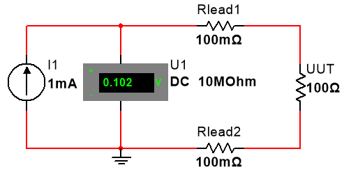

---
title: Resistance Measurements Part 1
description: Understanding two-wire, three-wire and four-wire resistance measurements, measurement errors and the effects of test lead resistance.
pubDate: 2026-11-18
topic: Metrology
image: ./images/resistance-measurements/schematic-1.png
imageAlt: Circuit diagram illustrating a two-wire resistance measurement, showing the test leads and unit under test.
---

Resistance can be measured using one of two methods: the constant current source method or the constant voltage source method.

Digital multimeters (DMMs) typically use the **constant current source method**, which is suitable for measuring resistances within their specified operating ranges. For higher resistance measurements, the constant voltage method may be used. This method can also be used to determine the voltage coefficient of a resistor by measuring its resistance at different constant voltages.

The constant current method can be implemented using three configurations: two-wire, three-wire and four-wire resistance measurements. The choice of configuration has a significant influence on measurement accuracy, particularly when measuring low resistance values.

## Constant current source method

Digital multimeters source different test currents depending on the resistance being measured. The following table illustrates typical test currents sourced by a DMM.

| Resistance | Current sourced by DMM |
|---|---:|
| 100 Ω | 1 mA |
| 1 kΩ | 1 mA |
| 10 kΩ | 100 μA |
| 100 kΩ | 10 μA |
| 1 MΩ | 1 μA |
| 10 MΩ | 0.1 μA |
| 100 MΩ | 0.1 μA |

## Two-wire resistance measurement

The two-wire configuration is one of the simplest methods of measuring resistance. Two wires are used to connect the digital multimeter to the unit under test (UUT). The same wires supply the test current and measure the voltage drop across the resistance.

The limitation of this configuration is that the measured voltage includes the voltage drops across the connecting leads. Consequently, the resistance of the test leads contributes to the measured resistance, introducing an error.

### Measurement example

Consider a 100 Ω resistor measured using a digital multimeter sourcing a current of 1 mA. Assume each connecting lead has a resistance of 100 mΩ.

The objective is to determine the effect of the connecting lead resistance on the measured value.

**Step 1: Calculate the voltage drop across the leads**

The total lead resistance is the sum of the resistance of the two connecting leads.

$$
R_{\text{leads}} = R_{\text{lead1}} + R_{\text{lead2}}
$$

$$
R_{\text{leads}} = 100\,m\Omega + 100\,m\Omega
$$

$$
R_{\text{leads}} = 200\,m\Omega
$$

Using Ohm's law:

$$
V = I \times R
$$

The voltage drop across the leads is:

$$
V_{\text{leads}} = 1\,mA \times 200\,m\Omega
$$

$$
V_{\text{leads}} = 0.2\,mV
$$

**Step 2: Calculate the voltage across the unit under test**

The voltage across the UUT is:

$$
V_{\text{UUT}} = I \times R_{\text{UUT}}
$$

$$
V_{\text{UUT}} = 1\,mA \times 100\,\Omega
$$

$$
V_{\text{UUT}} = 100\,mV
$$

**Step 3: Calculate the total measured voltage**

The multimeter measures the voltage drop across both the connecting leads and the UUT.

$$
V_{\text{measured}} = V_{\text{leads}} + V_{\text{UUT}}
$$

$$
V_{\text{measured}} = 0.2\,mV + 100\,mV
$$

$$
V_{\text{measured}} = 100.2\,mV
$$

**Step 4: Calculate the measured resistance**

Using Ohm's law:

$$
R_{\text{measured}} = \frac{V_{\text{measured}}}{I}
$$

$$
R_{\text{measured}} = \frac{100.2\,mV}{1\,mA}
$$

$$
R_{\text{measured}} = 100.2\,\Omega
$$

**Step 5: Calculate the measurement error**

The absolute measurement error is:

$$
E = R_{\text{measured}} - R_{\text{UUT}}
$$

$$
E = 100.2 - 100
$$

$$
E = 0.2\,\Omega
$$

The percentage error is:

$$
E(\%) = \frac{R_{\text{measured}}-R_{\text{UUT}}}{R_{\text{UUT}}}\times100
$$

$$
E(\%) = 0.2\%
$$

The connecting leads introduce an additional resistance of 0.2 Ω, resulting in a measurement error of 0.2%. This error is entirely attributable to the measurement configuration in this idealised example.

This demonstrates why two-wire resistance measurements can introduce significant errors, particularly when measuring low resistance values.

## Four-wire resistance measurement

The four-wire configuration is used to avoid the effect of lead resistance on resistance measurements. Four separate wires are used: two convey the test current to the resistance, while the other two measure the voltage directly across the unit under test.

The two current-carrying wires are commonly referred to as *force leads*, while the voltage-sensing wires are referred to as *sense leads*.

Since the voltmeter has a high input impedance, the current flowing through the sense leads is negligible. Consequently, the voltage drops across these leads are also negligible.

The voltage measured by the instrument therefore represents the voltage across the unit under test, without significant contributions from the resistance of the current-carrying leads.

This configuration is particularly useful when making accurate low-resistance measurements and is widely used in precision resistance calibration.

### Advantages of four-wire measurements

1. Minimises the influence of connecting lead resistance.
2. Improves measurement accuracy when measuring low resistance values.
3. Separates the current supply circuit from the voltage measurement circuit.
4. Is suitable for precision resistance measurements and calibration applications.

## Three-wire resistance measurement

The three-wire configuration is used to compensate for the effect of connecting lead resistance on resistance measurements. Three wires are used to connect the measuring instrument to the unit under test (UUT). The instrument uses the additional wire to compensate for the voltage drop introduced by the connecting leads.

This compensation relies on the assumption that the resistances of the connecting leads are approximately equal. The effect of lead resistance is therefore reduced, improving measurement accuracy compared to the two-wire configuration.

Although three-wire measurements provide better accuracy than two-wire measurements, they are generally less accurate than four-wire measurements, which largely eliminate the influence of lead resistance through separate current-carrying and voltage-sensing circuits.

